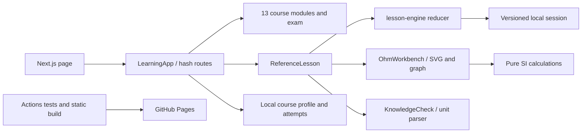

# VOLT. audit and remediation record

> Historical notes below describe the earlier iteration. The **Repository re-audit** further below supersedes its assertions about completeness and rendering correctness.

Date: 2026-10-20

## Product and architecture

VOLT. is a Next.js App Router static export. The client lesson engine owns route state in the hash, while `src/lib/progress.js` and the storage wrapper persist the learner profile, lesson attempts, bookmarks, and exam results in `localStorage`. There is no server account or remote result store. GitHub Pages serves the generated `out/` directory through the workflow in `.github/workflows/deploy-pages.yml`.

The code is intentionally split into content data (`src/data`), lesson UI (`src/components/LearningApp.js`), reusable motion (`LearningMotion`), the physics lab (`InteractiveLab`), and persistence (`src/lib`). The interactive lesson opening is implemented in `TeachingSequence`; it is separate from the reference sections so the content can be taught as a sequence of observations and decisions.

## Findings addressed in this iteration

- The lesson previously opened as a long reading page. A reusable `Problem → Beobachten → Vorhersagen → Experiment → Erklären → Anwenden → Reflektieren` sequence now appears before the reference material for every module.
- Formula strings were being shown as visible fallback text and contained inconsistent English placeholders. Formula rendering now uses local Wikimedia Math SVG assets with article revision links and CC BY-SA attribution. Missing assets produce a readable state instead of exposing malformed notation.
- Several content artifacts (`Schmollmund`, `Psweat`, `Uakt`, `Iut`, `𝓔ich selbst`, `Afields`, and similar tokens) were corrected to consistent German engineering notation. The `Notation` component renders subscripts as actual subscript elements.
- The visual language now has a technical instrument layer for navigation and learning stations, while explanation surfaces remain light and high contrast. Responsive breakpoints and reduced-motion handling are included.

## Verification contract

Run `npm test` for content, progress, and formula-source checks; run `npm run build` for the static export; run `npm run test:e2e` against the generated app for keyboard and route flows. A deployment is only considered valid after the GitHub Actions Pages workflow completes successfully for the pushed commit.

## Known boundaries

Progress is local to the browser profile and cannot be recovered after storage is cleared. The diagrams and formula SVGs are educational assets; they do not replace a certified measurement instrument. The virtual laboratory models idealized components and labels those assumptions in its guidance.

## Repository re-audit — 2026-10-20

### Executive summary and scope

The previous version has useful reference material, a functioning local profile, 65 quiz questions and a 35-question exam. Its seven-step opening only switches text, without an experiment controller or persisted learning sequence. This rebuild establishes one complete reference lesson, **Das Ohmsche Gesetz**, before migrating the other twelve modules. Earlier completion claims are not evidence that every module meets the new standard.

### Architecture map

Next.js 16.4.2; React 19.3.1; JavaScript; App Router. Hash navigation inside `LearningApp` selects screens. Static export is conditional on `STATIC_EXPORT=true`; GitHub Pages uses the `/ElektroTechnik` base path. There is no `pages/` directory, database, API backend, TypeScript configuration, server authentication or PDF generator.

### Confirmed defects and root causes

| Priority | Finding | Cause and correction |
|---|---|---|
| P0 | Term subscripts disappeared | `Notation` regex consumed the suffix but captured only the base. A tested token parser preserves both. This is a rendering defect in valid UTF-8 text. |
| P0 | Power formula showed an induction-voltage image | Incorrect asset ID in the mapping; replaced with the actual power image. Image integrity alone did not detect this semantic error. |
| P1 | Ohm lesson opened with current lesson text | `ohms-law` guide key did not match course ID `ohm`; corrected. |
| P1 | Clicking text steps was presented as interactive learning | No activity state or completion conditions. Replaced by a reducer, measurable activities, attempt history, reflection and storage for the reference lesson. |
| P1 | Physics and display logic were mixed | Extracted DC, equivalent resistance, RC and curve calculations. New instruments and graph use the same engine. |
| P1 | Numeric answers rejected equivalent units | `Number` accepted only bare decimals. A shared parser now handles German decimals and compatible SI units. |
| P1 | Competing CSS themes | New workspace uses a scoped stylesheet and explicit color tokens. Existing modules retain their current UI until migration. |

### Module audit

Each existing module has objectives, six reference sections, worked examples, a glossary, a basic parameter lab and five final quiz questions. Independent calculation tests cover existing numerical quiz answers. Text length alone does not establish teaching quality.

| Module | Existing activity / prerequisite | Migration status |
|---|---|---|
| Current | Charge per time / charge and closed circuit | Basic lab; guided sequence pending |
| Circuit types | Series and parallel / current and voltage | Shared resistor engine; guided sequence pending |
| Voltage | Work per charge / charge and energy | Basic lab; measurement sequence pending |
| Resistance | Copper geometry / voltage and current | Constant-temperature approximation; guided sequence pending |
| Ohm | DC measurements / voltage, current, resistance | Reference lesson: prediction, circuit, graph, measurement table, formula explorer, guided calculation, independent practice, checks and reflection |
| Energy/work | Constant power and time / power and units | Existing module; guided sequence pending |
| Power | DC load power / voltage and current | Incorrect formula source mapping fixed |
| Efficiency | Useful/input power / energy conservation | Existing module; guided sequence pending |
| Electric field | Parallel plates / voltage and charge | Uniform-field approximation; no edge fields |
| Capacitor | Charge/voltage / electric field | Basic lab; RC exercise migration pending |
| Magnets | Compass / magnetic poles | Qualitative dipole approximation |
| Electromagnetism | Long air-core coil / current and fields | No nonlinear core model |
| Magnetic quantities | Flux / area and field direction | Uniform field through a plane |

### Security and data integrity

No dynamic HTML injection, `dangerouslySetInnerHTML` or `eval` was found in `src`. React escapes user text. Existing imports are limited to 1 MB and normalized against profile schemas. New lesson sessions validate known steps, inputs and bounded attempt histories; stored measurement outputs are recalculated. Storage denial produces a warning and retains the current in-memory session. Profile reset removes guided sessions as well as quiz attempts. Course JSON export does not yet include guided session notes.

`npm audit --omit=dev` reported zero known production advisories on 2026-10-20. This is not a security certification. No authentication or official qualification service exists; all scores are local training results.

### Encoding, accessibility and limits

Known badge damage came from tokenization, not a missing font or broken UTF-8. Valid engineering symbols are retained. Automated checks cover German diacritics, Unicode replacement characters, mojibake and subscripts; screenshots are needed to verify rendered glyphs. There is no generated PDF with embedded fonts; PDF testing is NOT RUN.

The reference lesson supports keyboard ranges, labeled inputs, fieldsets, text feedback, focus states, reduced motion and a described circuit diagram. The reference module loads dynamically. Field Core Web Vitals and full screen-reader certification are NOT RUN. Concrete test and visual evidence is recorded in `QUALITY_ASSURANCE.md`.

## Fachinformatik beginner adaptation

Following the learner's clarification, the thirteen-topic structure, all laboratories, quiz/exam questions and stored profile model remain intact. This iteration adapts the existing lessons rather than replacing the course with a new track. `lesson-basics.js` supplies thirteen practical introductions/examples and concise original explanations for every one of the 78 section IDs. Existing long paragraphs remain in the data and can be expanded in the UI. The guided Ohm engine is retained with added IT context and notation help.

The previous notation help assumed learners already understood single-letter units. `units.js` now distinguishes physical quantity from unit: Q / C, C / F, P / W and energy / J or kWh. Numeric annotations supplement explicit legends; the parser only recognizes units after numbers, so a standalone quantity symbol C is not automatically labeled coulomb. Tests cover the Celsius/Coulomb distinction and preservation of original text.

The shared design now includes a functional source-rating experiment on the homepage and a row-based curriculum with IT context. These changes do not claim that all twelve remaining labs have migrated to the reference lesson engine.
